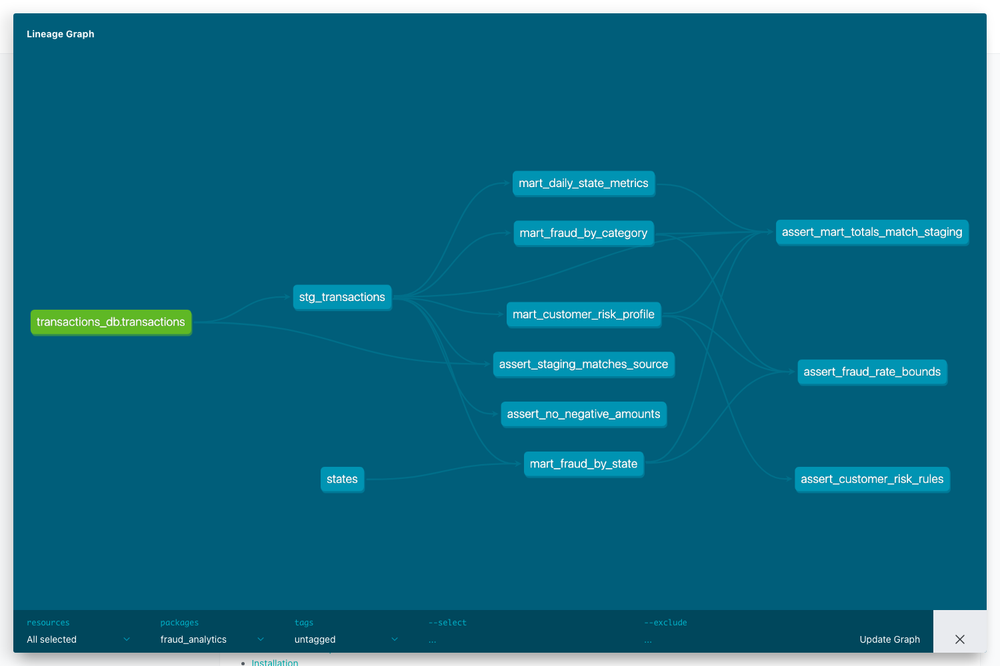

# dbt

Нужны Docker Compose и Python 3.10+. Данные — `../data/train.csv`.
Проект запускался с `dbt-core 1.10.21`, `dbt-clickhouse 1.9.8`, ClickHouse `25.8.33.6`.

## Запуск

Из корня репозитория:

```bash
cd dbt
python3 -m venv .venv
source .venv/bin/activate
pip install -r requirements.txt
export DBT_PROFILES_DIR="$PWD"

docker compose up -d --wait
python scripts/load_transactions.py
dbt deps
dbt debug
dbt seed
dbt run
dbt --no-use-colors test > docs/dbt-test.log 2>&1
cat docs/dbt-test.log
dbt docs generate
dbt docs serve --host 127.0.0.1 --port 8080
```

Документация откроется на [localhost:8080](http://localhost:8080), в ней можно посмотреть DAG.

Параметры подключения берутся из `CLICKHOUSE_HOST`, `CLICKHOUSE_PORT`, `CLICKHOUSE_USER`, `CLICKHOUSE_PASSWORD`.
По умолчанию используются `localhost:8123`, `student` / `homework` из Compose.
Исходная таблица — `transactions_db.transactions`, модели и справочник — в базе `analytics`.

## Схема

```text
../data/train.csv → загрузчик → transactions_db.transactions
                                         │
                                  stg_transactions
                                         │
                                         ├── mart_daily_state_metrics
                                         ├── mart_fraud_by_category
                                         ├── mart_fraud_by_state
                                         └── mart_customer_risk_profile
```

Справочник `states` добавляет названия штатов в `mart_fraud_by_state`.



```text
dbt/
├── docker-compose.yml        # ClickHouse
├── requirements.txt          # Зависимости
├── dbt_project.yml           # Настройки и пороги
├── profiles.yml              # Подключение
├── packages.yml              # dbt_utils, dbt_date, dbt_expectations
├── scripts/                  # Загрузчик и SQL исходной таблицы
├── models/
│   ├── sources/              # Описание исходной таблицы
│   ├── staging/              # Подготовка транзакций
│   └── marts/                # Витрины
├── macros/                   # Сегменты суммы и поддержка dbt_date для ClickHouse
├── seeds/                    # 50 штатов и DC
├── tests/                    # Singular tests
└── docs/                     # Лог тестов и скриншот DAG
```

Описания колонок и стандартные тесты находятся в YAML рядом с моделями.
Singular tests проверяют суммы, границы fraud_rate, сохранение итогов и правила риска.

Пороги задаются в `dbt_project.yml`: крупная сумма — от 1000; HIGH — фрод от 1%,
MEDIUM — есть фрод ниже порога, LOW — фрода нет. Ключ клиента составлен из имени и адреса, так как ID клиента отсутствует.

Артефакты проверки: [лог тестов](docs/dbt-test.log), [DAG из dbt Docs](docs/dbt-dag.png).
На полном датасете прошли все 46 тестов.
